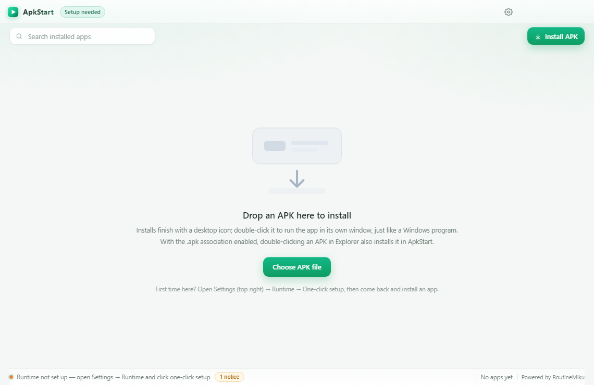
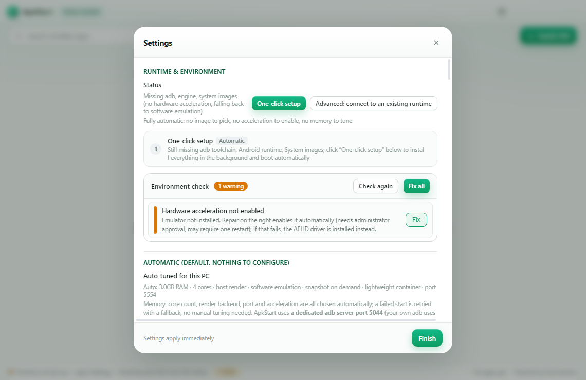

# ApkStart English (Bahasa Indonesia)

**UI bahasa Inggris tidak resmi untuk [ApkStart](https://github.com/RoutineMiku/apkstart) v0.5.3** — peluncur aplikasi Android untuk Windows: pasang APK, buat shortcut desktop, dan setiap aplikasi berjalan di jendelanya sendiri.

ApkStart bagus, tapi seluruh label, dialog, notifikasi, dan pesan log-nya ditulis langsung dalam bahasa Mandarin. Repo ini menerjemahkan semuanya ke bahasa Inggris dengan cara yang bisa dipasang ulang setiap kali aplikasi diperbarui.





> Tidak berafiliasi dengan RoutineMiku. ApkStart berlisensi MIT; ini terjemahan UI dari komunitas.

## Ringkasan

| | |
|---|---|
| String diterjemahkan | **1.273** (UI, tray, notifikasi, dialog, installer, diagnostik, log) |
| Penggantian | **6.242** di **46 file** |
| Sisa bahasa Mandarin di luar komentar kode | **0** |
| Versi | hanya v0.5.3 |
| Gambar Android / QEMU / komponen Google yang dibundel | tidak ada |

Dua cara pakai:

1. **Build portable English** – unduh zip rilis, ekstrak, jalankan `ApkStart.exe`. Tanpa patch manual.
2. **Patch instalasi Anda** – satu skrip PowerShell menukar file UI dan menyimpan cadangan.

## Cara 1 — build portable English (paling mudah)

1. Unduh `ApkStart-v0.5.3-win64-portable-en.zip` dari [Releases](../../releases).
2. Ekstrak di mana saja (misal `D:\ApkStart`).
3. Jalankan `ApkStart.exe`.

Saat aplikasi pertama dijalankan, runtime Android tetap diunduh seperti build asli. Tidak ada yang dibundel tambahan.

## Cara 2 — patch ApkStart v0.5.3 yang sudah terpasang

1. Tutup ApkStart (ikon tray → klik kanan → **Quit**).
2. Unduh repo ini (**Code** → **Download ZIP**) lalu ekstrak.
3. Jalankan:

```powershell
powershell -ExecutionPolicy Bypass -File .\install-en.ps1
```

Skrip mencari ApkStart otomatis (proses yang berjalan, entri uninstall, atau folder instalasi umum). Kalau tidak ketemu, berikan path-nya:

```powershell
powershell -ExecutionPolicy Bypass -File .\install-en.ps1 -AppDir "C:\Users\me\Apps\ApkStart\resources\app" -StopApp
```

Sebelum menulis apa pun, skrip:

- memastikan `package.json` berisi `0.5.3`;
- membandingkan SHA-256 setiap file dengan file asli v0.5.3;
- mencadangkan semuanya ke `%LOCALAPPDATA%\apkstart-english\backup\...`.

Kalau ada file yang sudah dimodifikasi, skrip berhenti dan menampilkan daftarnya (`-Force` untuk memaksa).

### Kembali ke bahasa Mandarin

```powershell
powershell -ExecutionPolicy Bypass -File .\install-en.ps1 -Restore
# atau
powershell -ExecutionPolicy Bypass -File .\restore-zh.ps1
```

Cadangan terbaru untuk instalasi itu dipulihkan dan diverifikasi hash-nya.

## Yang diterjemahkan

- Jendela utama: sidebar, kartu aplikasi, area drop, status, tooltip
- Pengaturan: semua grup (Runtime & lingkungan, Otomatis, Jendela aplikasi, Tombol mouse, Pemetaan tombol, Performa & sumber daya, Sumber unduhan & update, Runtime, Pengaturan sistem Android, Desktop & aplikasi, Berbagi file, Integrasi sistem, Update, Tentang)
- Menu tray, toast, dialog konfirmasi, notifikasi Windows
- Alur pasang / buka / hapus aplikasi, pemetaan error dan saran perbaikan
- Diagnostik: pemeriksaan lingkungan, alasan gagal, petunjuk, teks laporan diagnostik
- Backend runtime: QEMU/Android-x86 bawaan, MuMu, FydeOS, dan mode menyambung ke runtime yang sudah ada
- Modul inti: deployment runtime, start/stop emulator, perbaikan jaringan, pembersihan, updater, berbagi file, shortcut, splash, dan panduan setup pertama
- Detail locale: `<html lang="en">`, `toLocaleDateString('en-US')`, pengurutan nama dengan locale `en`, halaman unduh VC++ versi Inggris

**Sengaja tidak diterjemahkan:** komentar kode, UI sistem Android di dalam VM (itu Android, bukan ApkStart), dan gambar QR WeChat/Douyin milik penulis.

## Setelah ApkStart diperbarui

ApkStart punya updater bawaan. Saat versi baru dipasang, folder `resources\app` diganti dan **UI kembali Mandarin**. Itu normal.

- Jalankan lagi `install-en.ps1`. Kalau versinya berubah, pemeriksaan hash akan menolak dan memberi tahu.
- Untuk versi baru, terjemahan bisa dibangun ulang (lihat README bahasa Inggris). String baru yang belum ada di katalog akan tetap Mandarin dan dilaporkan oleh tool.

## Membangun ulang patch

Butuh Node.js 20+ dan folder `resources\app` asli dari versi yang dituju.

```powershell
node scripts\build-en.js --src "C:\path\ke\resources\app-asli" --out build\app
node scripts\make-patch.js --src "C:\path\ke\resources\app-asli" --built build\app
node scripts\verify-patch.js --src "C:\path\ke\resources\app-asli"
```

`build-en.js` menulis `build\i18n-report.json`; build yang bersih menampilkan `0` sisa bahasa Mandarin di luar komentar.

## Lisensi dan kredit

- **ApkStart** © ApkStart contributors, MIT — <https://github.com/RoutineMiku/apkstart>. Repo ini memuat salinan modifikasi file UI dari tag `v0.5.3`.
- Terjemahan Inggris dirilis dengan lisensi MIT yang sama (lihat [LICENSE](LICENSE)).
- ApkStart mengunduh image Android, binary emulator, dan komponen Google dari vendornya masing-masing. **Tidak ada yang didistribusikan di sini**; zip rilis hanya berisi program ApkStart asli plus file teks terjemahan.

Menemukan terjemahan yang kurang tepat? Buka issue dengan nama jendela dan teks Inggrisnya.
