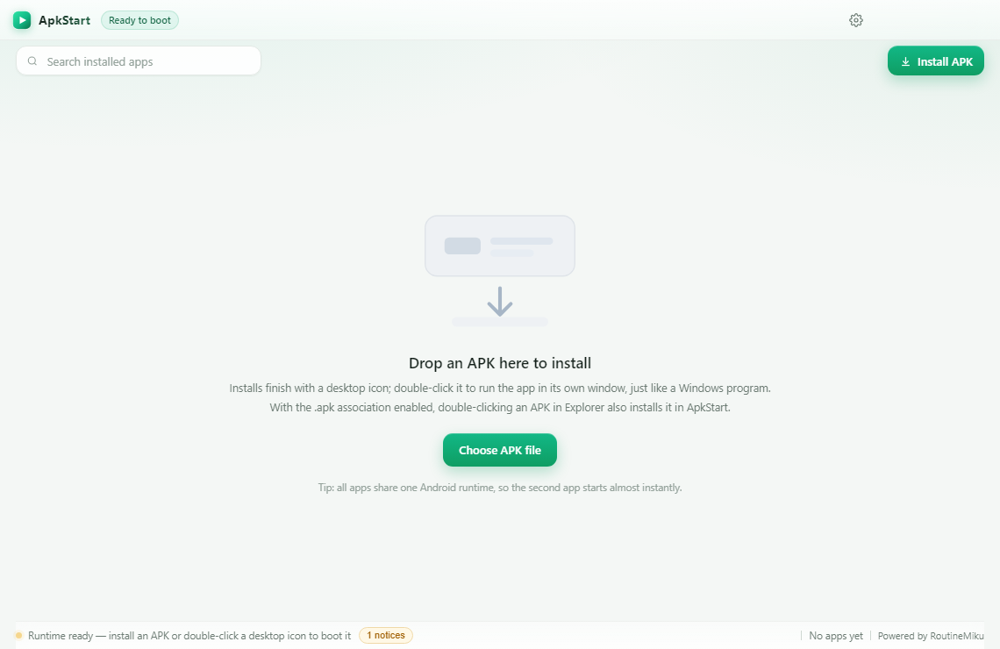
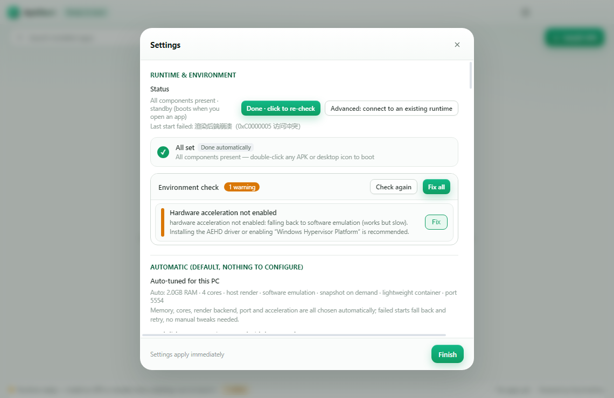

# ApkStart English

[](https://github.com/soeadeboee/apkstart-english/actions/workflows/verify.yml)
[](LICENSE)

**Unofficial English UI for [ApkStart](https://github.com/RoutineMiku/apkstart) v0.4.3** — a Windows launcher that installs Android APKs and runs each app in its own window.

ApkStart is excellent, but every label, dialog, notification and log line is hard-coded Chinese. This repo turns all of it into English, and does it in a way you can re-apply after every update.





> Not affiliated with RoutineMiku. ApkStart is MIT-licensed; this is a community translation of its UI.

## What you get

| | |
|---|---|
| Strings translated | **1,024** (UI, tray, notifications, dialogs, installer, diagnostics, logs) |
| Replacements | **2,315** across **35 files** |
| Chinese left outside code comments | **0** |
| Version pin | v0.4.3 only |
| Bundled Android images / QEMU / Google components | none |

Two ways to use it:

1. **Portable English build** – download the release zip, extract, run `ApkStart.exe`. No patching needed.
2. **Patch your own install** – one PowerShell script swaps the UI files and keeps a backup.

## Option 1 — portable English build (easiest)

1. Download `ApkStart-v0.4.3-win64-portable-en.zip` from [Releases](../../releases).
2. Extract it anywhere (e.g. `D:\ApkStart`).
3. Run `ApkStart.exe`.

The first app launch still downloads the Android runtime, exactly like the original build. Nothing else is bundled.

## Option 2 — patch an existing ApkStart v0.4.3

1. Quit ApkStart (tray icon → right click → **Quit**).
2. Download this repo (green **Code** button → **Download ZIP**) and extract it.
3. Run:

```powershell
powershell -ExecutionPolicy Bypass -File .\install-en.ps1
```

The script finds ApkStart automatically (running process, uninstall entry, or common install folders). If it cannot, pass the folder explicitly:

```powershell
powershell -ExecutionPolicy Bypass -File .\install-en.ps1 -AppDir "C:\Users\me\Apps\ApkStart\resources\app" -StopApp
```

Before writing anything it:

- checks `package.json` says `0.4.3`;
- compares every target file with the SHA-256 of the stock v0.4.3 file;
- backs everything up to `%LOCALAPPDATA%\apkstart-english\backup\...`.

If a file was modified, it stops and lists it instead of overwriting silently (`-Force` overrides).

### Back to Chinese

```powershell
powershell -ExecutionPolicy Bypass -File .\install-en.ps1 -Restore
# or
powershell -ExecutionPolicy Bypass -File .\restore-zh.ps1
```

The newest backup for that install is restored and hash-verified.

## What is translated

- Main window: sidebar, app cards, drop zone, status strip, tooltips
- Settings: every tab (Runtime, App windows, Performance, Sources, System integration, Software update, About)
- Tray menu, in-app toasts, confirm dialogs, Windows notifications
- Install / launch / uninstall flows, error mapping and repair suggestions
- Diagnostics: environment check, failure reasons, hints, diagnostic report text
- Core modules: runtime deployment, emulator start/stop, networking repair, cleanup, updater, file sharing, shortcuts
- Locale details: `<html lang="en">`, `toLocaleDateString('en-US')`, name sorting with the `en` locale, English VC++ download page

**Not translated on purpose:** code comments (developers only), the Android system UI inside the VM (that is Android, not ApkStart), and the author's WeChat/Douyin QR images.

## After an ApkStart update

ApkStart has a built-in updater. When it installs a new version it replaces `resources\app` and **the UI becomes Chinese again**. That is expected.

- Re-run `install-en.ps1`. If the version changed, the hash check will refuse and tell you.
- For a new version the translation can be rebuilt: see below. New or changed Chinese strings will simply stay Chinese until the catalogs are updated — the tool reports them.

## Rebuilding the patch

Requirements: Node.js 20+, a pristine `resources\app` tree of the target version (e.g. from the official portable zip).

```powershell
# 1. apply the catalogs (+ fixes.tsv) to the Chinese sources
node scripts\build-en.js --src "C:\path\to\pristine\resources\app" --out build\app

# 2. copy only the changed files into patch\app and write patch\manifest.json
node scripts\make-patch.js --src "C:\path\to\pristine\resources\app" --built build\app

# 3. verify every hash in the manifest
node scripts\verify-patch.js --src "C:\path\to\pristine\resources\app"
```

`build-en.js` prints a summary and writes `build\i18n-report.json`, which lists any Chinese left outside comments and regex literals. A clean build shows `0`.

### How the catalogs work

`locales\ui.tsv`, `main.tsv` and `core.tsv` are plain TSV:

```
<Chinese source string>\t<English text>
```

- Entries are applied longest-first, so a short string never eats part of a longer one.
- `${...}` placeholders are copied verbatim; a row whose placeholder count differs is skipped and reported.
- A real newline inside a key is stored as `<NL>` (a TSV row must stay on one line).
- Straight quotes in the English text are converted to typographic quotes (`’`, `“`, `”`) so the text stays valid inside `'...'`, `"..."` and template literals.
- Text inside regex literals is never touched: those patterns intentionally match Chinese output from adb/emulator.
- `locales\fixes.tsv` holds the handful of things a raw-string catalog cannot express: mixed Chinese/English fragments, plural forms (`1 app` / `2 apps`), `<html lang>`, date and sort locales. Escapes: `\n`, `\t`, `\\`.

## Staying in sync with upstream

This repo deliberately pins one upstream version at a time, so the installer can
verify hashes instead of guessing. To keep up without losing track:

```powershell
node scripts\check-upstream.js
```

It compares `patch\manifest.json` with the latest ApkStart release and prints the
rebuild pointer. The scheduled workflow `.github/workflows/upstream-watch.yml`
runs the same check every day and opens a tracking issue when a new upstream
version appears; `.github/workflows/verify.yml` lints the patch and catalogs on
every push.

The full update checklist lives in [CONTRIBUTING.md](CONTRIBUTING.md#2-updating-to-a-new-upstream-release).

### Getting the translation upstream

ApkStart requires Chinese UI text in its sources, so a 35-file English patch
cannot be merged directly. The route that respects upstream's rules is a
**build-time locale catalog** (Chinese sources unchanged, opt-in English build).
If you want to push for that, open an issue upstream first with a screenshot and
the rebuild command; keep any PR small. Details in
[CONTRIBUTING.md](CONTRIBUTING.md#3-upstream-contributions).

## Repo layout

```
install-en.ps1        apply / restore the patch (auto-detects the install)
restore-zh.ps1        wrapper for install-en.ps1 -Restore
locales\*.tsv         translation catalogs + version-specific fixes
patch\app\            translated files (only files that differ from upstream)
patch\manifest.json   upstream + English SHA-256 per file
scripts\build-en.js   catalog applier
scripts\make-patch.js build patch\app + manifest
scripts\verify-patch.js  check hashes against patch\app and a pristine tree
scripts\lint-patch.js    CI check: syntax, catalogs, manifest
scripts\check-upstream.js  compare with the latest ApkStart release
.github\workflows\    verification + daily upstream watch
docs\                 screenshots
```

## Credits and license

- **ApkStart** © ApkStart contributors, MIT — <https://github.com/RoutineMiku/apkstart>. This repo contains modified copies of its UI files from tag `v0.4.3`.
- The English translation is released under the same MIT license (see [LICENSE](LICENSE)).
- ApkStart itself downloads Android system images, emulator binaries and Google components from their vendors. **None of those are distributed here**, and the release zip contains only the original ApkStart program plus translated text files.

If you find a mistranslation, open an issue with the window name and the exact English text.
